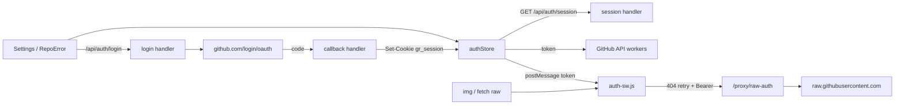
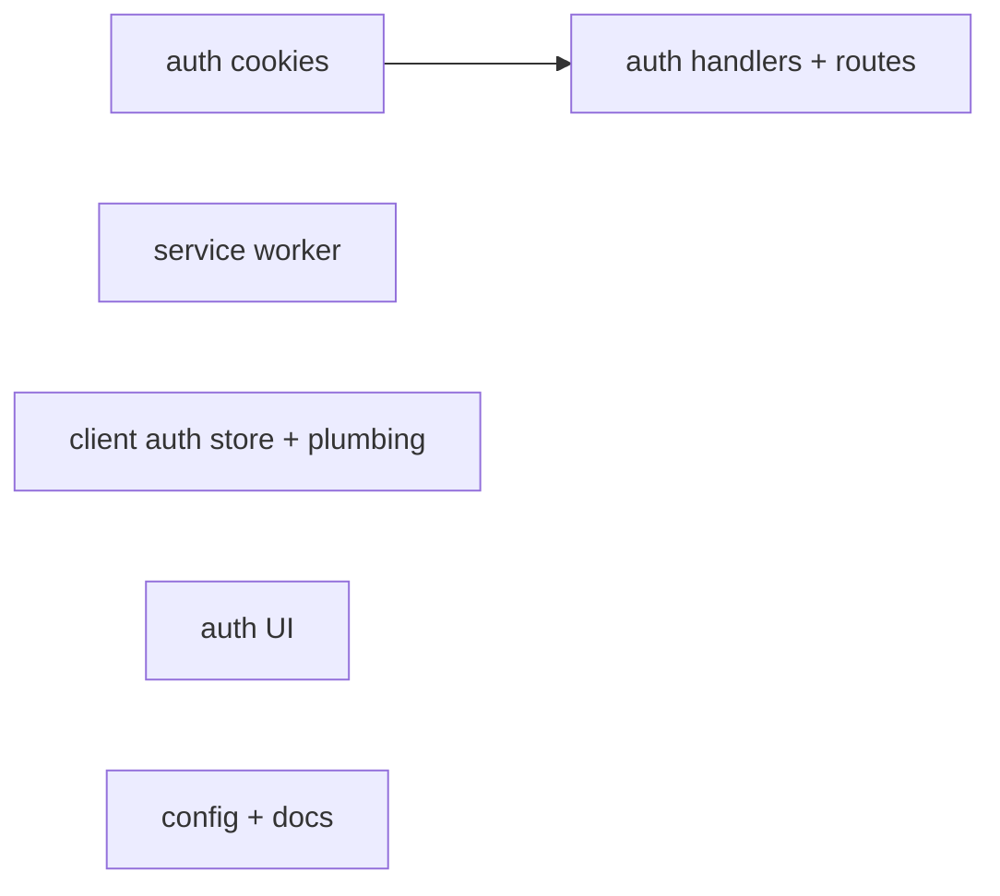
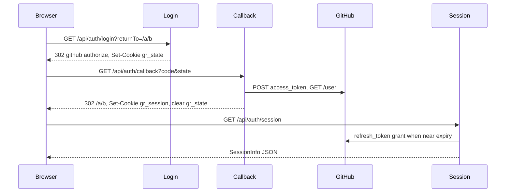

# GitHub sign-in and private repositories

**Goal:** Let users sign in with GitHub (GitHub App user authorization) instead of pasting a token, raising the API limit to 5,000/h, and, as an opt-in, read the private repositories they choose to give the app.
**Architecture:** Vercel functions under `/api/auth/*` run the OAuth web flow and keep the tokens in one httpOnly cookie scoped to `/api/auth`. The page fetches a short-lived access token from `/api/auth/session` and keeps it only in memory. A service worker, registered only while a token exists, retries raw-file requests that 404 through a same-origin, uncached proxy with the token attached, so `` tags keep working unchanged for private repositories.
**Tech stack:** React 19 + TypeScript + Zustand (client), Vercel Node functions with Web `Request`/`Response` (server), a classic service worker in plain JS, `node --test` with built-in type stripping (Node 22.18+) for tests.
**Spec:** none (agent_specs off); this doc is the design.
**Detail:** contracts
**Target-min:** 11
**Ignore:** .yarn/, .pnp.cjs, .pnp.loader.mjs, dist/

## Global constraints

- Env vars (server only): `GITHUB_APP_CLIENT_ID`, `GITHUB_APP_CLIENT_SECRET`, `GITHUB_APP_SLUG` (optional; enables the install link). Missing client id or secret means sign-in is disabled.
- Session cookie: name `gr_session`, value base64url(JSON `{at, atExp, rt, rtExp, login, avatarUrl}`; `atExp`/`rtExp` are epoch ms or null), attributes `Path=/api/auth; HttpOnly; Secure; SameSite=Lax`. State cookie `gr_state`, same attributes, `Max-Age=600`, value `<state>.<base64url(returnTo)>`.
- `GET /api/auth/session` → `200`, `Cache-Control: no-store`, JSON `SessionInfo`: `{enabled: false}` or `{enabled: true, user: {login: string, avatarUrl: string} | null, accessToken: string | null, expiresAt: number | null, installUrl: string | null}`. `installUrl` = `https://github.com/apps/<slug>/installations/new` or null.
- Access tokens are refreshed server-side when within 60 s of `atExp`. A failed refresh clears the cookie and returns `user: null`.
- Service worker file `/auth-sw.js`, core `/auth-sw-core.js` (exposes `self.AuthSwCore`). Page → SW message `{type: 'auth-token', token: string | null}`; SW → page request `{type: 'auth-token-request'}` over a `MessageChannel`, reply `{token: string | null}`.
- Authenticated raw proxy path `/proxy/raw-auth/<owner>/<repo>/<ref>/<path>` → `https://raw.githubusercontent.com/...`, response headers `Cache-Control: private, no-store`.
- Effective token everywhere = OAuth access token, else the personal access token from settings.
- Tests: `node --import ./tests/register-ts.mjs --test tests/` (files `tests/*.test.ts` / `*.test.mjs`, importing sources by relative path with extension). Also `yarn tsc -b` and `yarn eslint .` must pass.
- UI text in English, like the rest of the app. Prettier style of the repo (no semicolons, single quotes, `bracketSpacing: false`).

## Main diagram

## File structure

- `api/_lib/authCookies.ts` — cookie parse/serialize, session encode/decode, `safeReturnTo`.
- `api/_lib/authHandlers.ts` — login, callback, session (with refresh), logout handlers; `fetch` injected.
- `api/auth/{login,callback,session,logout}.ts` — thin Vercel route wrappers.
- `public/auth-sw-core.js` — pure raw-target parsing and the 404-retry handler factory.
- `public/auth-sw.js` — service worker wiring (install, activate, message, fetch).
- `src/shared/auth/authStore.ts` — session state, sign in/out, token getters.
- `src/shared/auth/authServiceWorker.ts` — register/unregister the SW, answer token requests.
- `tests/authCookies.test.ts`, `tests/authHandlers.test.ts`, `tests/authSwCore.test.mjs`.

## Task graph

## Predicted schedule

Generated by `superlite-cli plan_tools schedule`.

## Decisions

- Ruling: GitHub App, not OAuth App (because OAuth Apps have no read-only private scope; the App asks for Contents: read + Metadata: read and the user picks repositories at install).
- Ruling: tokens in one httpOnly cookie scoped to `Path=/api/auth` (because the `/proxy/*` rewrites forward cookies to GitHub otherwise).
- Ruling: service worker retries only on 404 (because public images must keep loading straight from raw.githubusercontent.com with no Vercel traffic).
- Ruling: no ZIP fallback for private repositories (because codeload needs a redirect token the browser cannot read; the tree API works with the token).
- Ruling: no token revocation on sign-out, only the cookie is cleared (because revocation needs the client secret per call and the token expires in 8 h).
- Ruling: tests use `node --test` with type stripping, no new dependency (because the repo has no test runner and a zero-install cache).
- Assumption: Vercel external rewrites forward the `Authorization` header (to confirm after deploy; if not, `/proxy/raw-auth` becomes a function).

## Section: server auth (HTTP service / auth)

**Probe entry:** call=api/_lib/authHandlers.handleSession

### T1 auth cookies · Complexity 3 · Est. context 26k
**Owns:** api/_lib/authCookies.ts, tests/authCookies.test.ts, tests/register-ts.mjs
**Components:** 1
**LOC owned:** 140
**Tests:** fast
**Kind:** design
**Model:** sonnet
**Est. time:** 2 min
**Consumes:** none
**Produces:** parseCookies(header: string | null) -> Record<string, string>
e.g. parseCookies('a=1; gr_session=xyz') -> {a: '1', gr_session: 'xyz'}
e.g. parseCookies(null) -> {}
**Produces:** serializeCookie(name: string, value: string, maxAgeSeconds: number) -> string
e.g. serializeCookie('gr_state', 'v', 600) -> 'gr_state=v; Path=/api/auth; HttpOnly; Secure; SameSite=Lax; Max-Age=600'
e.g. serializeCookie('gr_session', '', 0) -> 'gr_session=; Path=/api/auth; HttpOnly; Secure; SameSite=Lax; Max-Age=0'
**Produces:** encodeSession(session: StoredSession) -> string · decodeSession(value: string | undefined) -> StoredSession | null
e.g. decodeSession(encodeSession({at: 'ghu_1', atExp: 1000, rt: 'ghr_1', rtExp: null, login: 'kim', avatarUrl: 'https://a/x'})) -> the same object
e.g. decodeSession('not-base64-json') -> null
**Produces:** safeReturnTo(value: string | null) -> string
e.g. safeReturnTo('/owner/repo?filter=gui') -> '/owner/repo?filter=gui'
e.g. safeReturnTo('//evil.com') -> '/'
**Produces:** type StoredSession = {at: string; atExp: number | null; rt: string | null; rtExp: number | null; login: string; avatarUrl: string}
**Review Focus:** `test_return_to_rejects_offsite`: `'//evil.com'`, `'/\\evil.com'`, `'https://evil.com'`, `''`, `null`, `'owner/repo'` all give `'/'`; `test_decode_rejects_wrong_shape`: base64url of `{"at":1}` gives null; `test_cookie_values_url_safe`: encoded session matches `/^[A-Za-z0-9_-]+$/`.
**Test code:** named tests above plus one per `e.g.` line, in `tests/authCookies.test.ts` importing `../api/_lib/authCookies.ts`.
**Steps:** 1 failing tests, 2 run: FAIL, 3 implement, 4 run: PASS
**Notes:** `tests/register-ts.mjs` calls `module.register` with a resolve hook: a relative `.js` specifier that fails with ERR_MODULE_NOT_FOUND is retried as `.ts`. Run tests as `node --import ./tests/register-ts.mjs --test tests/`. base64url via `Buffer.from(json).toString('base64url')`. `decodeSession` checks `at` and `login` are strings. Cookie values are not URL-encoded beyond base64url.

### T2 auth handlers and routes · Complexity 6 · Est. context 40k

**Owns:** api/_lib/authHandlers.ts, api/auth/login.ts, api/auth/callback.ts, api/auth/session.ts, api/auth/logout.ts, tests/authHandlers.test.ts
**Components:** 2
**LOC owned:** 260
**Tests:** fast
**Kind:** design
**Model:** sonnet
**Est. time:** 4 min
**Consumes:** parseCookies(header: string | null) -> Record<string, string> (T1) · serializeCookie(name: string, value: string, maxAgeSeconds: number) -> string (T1) · encodeSession(session: StoredSession) -> string (T1) · decodeSession(value: string | undefined) -> StoredSession | null (T1) · safeReturnTo(value: string | null) -> string (T1)
**Produces:** type AuthEnv = {GITHUB_APP_CLIENT_ID?: string; GITHUB_APP_CLIENT_SECRET?: string; GITHUB_APP_SLUG?: string}
**Produces:** handleLogin(request: Request, env: AuthEnv) -> Response
**Produces:** handleCallback(request: Request, env: AuthEnv, fetchImpl: typeof fetch) -> Promise<Response>
**Produces:** handleSession(request: Request, env: AuthEnv, fetchImpl: typeof fetch, now: number) -> Promise<Response>
e.g. no client id -> 200 {enabled: false}
e.g. configured, no cookie, slug 'git-resource' -> 200 {enabled: true, user: null, accessToken: null, expiresAt: null, installUrl: 'https://github.com/apps/git-resource/installations/new'}
e.g. valid cookie atExp = now + 3600000 -> 200 {enabled: true, user: {login: 'kim', avatarUrl: 'https://a/x'}, accessToken: 'ghu_1', expiresAt: now + 3600000, installUrl: null}
**Produces:** handleLogout(request: Request) -> Response
**Review Focus:** `test_callback_state_mismatch_400`: query state `a`, cookie state `b` gives 400 and no `gr_session` cookie; `test_callback_missing_state_cookie_400`; `test_callback_denied_redirects`: `?error=access_denied&state=s` with matching cookie gives 302 to the stored returnTo and no session; `test_callback_sets_session`: fake token response `{access_token: 'ghu_1', expires_in: 28800, refresh_token: 'ghr_1', refresh_token_expires_in: 15897600}` + `/user` `{login: 'kim', avatar_url: 'https://a/x'}` gives 302 to returnTo, `gr_session` cookie decoding to those values, and `gr_state` cleared; `test_session_refreshes_near_expiry`: atExp = now + 30000 calls the token endpoint with `grant_type=refresh_token` and `refresh_token=ghr_1` and returns the new token with a new Set-Cookie; `test_session_refresh_failure_clears`: token endpoint `{error: 'bad_refresh_token'}` gives `user: null` and `gr_session` Max-Age=0; `test_session_no_store`: Cache-Control `no-store`; `test_logout_requires_post`: GET gives 405, POST gives 204 with cleared cookie; `test_login_redirect`: 302 Location host github.com, path `/login/oauth/authorize`, `client_id`, `state` equal to the `gr_state` cookie's state, `redirect_uri` = `<origin>/api/auth/callback`; `test_login_disabled_404`.
**Test code:** named tests above in `tests/authHandlers.test.ts`, importing `../api/_lib/authHandlers.ts`, with a fake `fetchImpl` that records calls.
**Steps:** 1 failing tests, 2 run: FAIL, 3 implement, 4 run: PASS
**Notes:** `authHandlers.ts` imports `./authCookies.js` (the repo's server import style; T1's resolve hook maps it to `.ts` in tests). Token exchange: `POST https://github.com/login/oauth/access_token`, headers `Accept: application/json`, `Content-Type: application/json`, body `{client_id, client_secret, code, redirect_uri}`; refresh body `{client_id, client_secret, grant_type: 'refresh_token', refresh_token}`. User: `GET https://api.github.com/user` with `Authorization: Bearer`, `User-Agent: git-resource`. Missing `expires_in` means a non-expiring token (`atExp: null`). Cookie Max-Age = refresh expiry if any, else 180 days. Each route file: `export function GET(request: Request) { return handleX(request, process.env, fetch, Date.now()) }` (logout exports `POST` and `GET`).

## Section: service worker (concurrency / protocol)

**Probe entry:** call=public/auth-sw-core.createRawHandler

### T3 service worker · Complexity 5 · Est. context 30k
**Owns:** public/auth-sw-core.js, public/auth-sw.js, tests/authSwCore.test.mjs
**Components:** 2
**LOC owned:** 190
**Tests:** fast
**Kind:** design
**Model:** sonnet
**Est. time:** 3 min
**Consumes:** none
**Produces:** AuthSwCore.parseRawTarget(url: string, origin: string) -> {repoKey: string, rest: string} | null
e.g. parseRawTarget('https://raw.githubusercontent.com/Foo/Bar/main/a%20b.png', 'https://gitresource.com') -> {repoKey: 'foo/bar', rest: 'Foo/Bar/main/a%20b.png'}
e.g. parseRawTarget('https://gitresource.com/proxy/raw/o/r/v1/x.mcmeta', 'https://gitresource.com') -> {repoKey: 'o/r', rest: 'o/r/v1/x.mcmeta'}
e.g. parseRawTarget('https://example.com/o/r/main/x.png', 'https://gitresource.com') -> null
**Produces:** AuthSwCore.createRawHandler(deps: {fetch: typeof fetch, getToken: () => Promise<string | null>}) -> (request: Request, origin: string) -> Promise<Response>
**Review Focus:** `test_no_token_passthrough`: getToken null gives exactly one fetch, of the original request; `test_public_ok_single_fetch`: raw 200 gives one fetch with `mode: 'cors'`, `credentials: 'omit'`; `test_404_retries_with_bearer`: raw 404 then proxy 200 gives a second fetch to `/proxy/raw-auth/<rest>` with `Authorization: Bearer t` and `cache: 'no-store'`, returns the 200; `test_known_private_skips_raw`: a second request to the same repo makes only the proxy fetch; `test_retry_failure_returns_original`: proxy 404 returns the original 404 and does not mark the repo private; `test_other_url_not_handled`: parseRawTarget null for `/api/auth/session` and short paths `https://raw.githubusercontent.com/o/r`; `test_token_change_clears_private`: handler `reset()` (or a new handler) forgets private repos.
**Test code:** named tests in `tests/authSwCore.test.mjs`: set `globalThis.self = globalThis`, `await import('../public/auth-sw-core.js')`, use `self.AuthSwCore`.
**Steps:** 1 failing tests, 2 run: FAIL, 3 implement, 4 run: PASS
**Notes:** `createRawHandler` returns a function with a `reset()` property. The same-origin `/proxy/raw/` first attempt is `fetch(request)`. `auth-sw.js`: `importScripts('/auth-sw-core.js')`; `install` → `skipWaiting()`; `activate` → `clients.claim()`; `message` `auth-token` sets the in-memory token and calls `reset()`; `fetch` handles only GET requests that `parseRawTarget` accepts; `getToken` returns the memory token, else asks `clients.get(event.clientId)` with a MessageChannel and a 1 s timeout (null on timeout). Plain ES2020, no modules.

## Section: client (web UI)

**Probe entry:** call=src/shared/auth/authStore.getGithubToken

### T4 client auth store and token plumbing · Complexity 5 · Est. context 45k
**Owns:** src/shared/auth/authStore.ts, src/shared/auth/authServiceWorker.ts, src/main.tsx, src/shared/api/github/callGithubWorker.ts, src/features/repo/image-cell/AnimatedSprite.tsx, src/features/repo/download/SpriteDownloadDialog.tsx
**Components:** 2
**LOC owned:** 200
**Tests:** fast
**Kind:** design
**Model:** sonnet
**Est. time:** 4 min
**Consumes:** GET /api/auth/session SessionInfo (Global constraints)
**Produces:** useAuthStore: zustand store `{status: 'loading' | 'disabled' | 'signedOut' | 'signedIn', user: {login: string, avatarUrl: string} | null, installUrl: string | null, accessToken: string | null, load(): Promise<void>, signIn(): void, signOut(): Promise<void>}`
e.g. session `{enabled: false}` -> status 'disabled'
e.g. session `{enabled: true, user: null, ...}` -> status 'signedOut'
e.g. fetch rejects or non-JSON -> status 'disabled'
**Produces:** getGithubToken() -> string · useGithubToken() -> string
e.g. accessToken 'ghu_1', settings token 'ghp_2' -> 'ghu_1'
e.g. accessToken null, settings token 'ghp_2' -> 'ghp_2'
**Produces:** setupAuthServiceWorker() -> Promise<void>
**Review Focus:** `refresh_timer`: `load()` schedules the next `load()` at `expiresAt - now - 120000` ms, at least 30000, and clears any earlier timer; `signin_return_to`: `signIn()` goes to `/api/auth/login?returnTo=` + encoded `pathname + search`; `sw_only_with_token`: no token → existing `/auth-sw.js` registration unregistered, nothing registered; token → register and post `{type: 'auth-token', token}` on every token change; `startup_gate`: `main.tsx` awaits `load()` then `setupAuthServiceWorker()` (both capped at 3 s total) before rendering only when localStorage `auth.signedIn` is `'1'` or a settings token exists, otherwise renders first.
**Test code:** none runnable (no DOM test runner); verification is `yarn tsc -b` and `yarn eslint .`. Ruling: client code is checked by types and the final review.
**Steps:** 1 implement, 2 run tsc + eslint: PASS
**Notes:** `authStore` writes `localStorage['auth.signedIn'] = '1'` when signed in and removes it otherwise. `signOut()` POSTs `/api/auth/logout`, then sets `signedOut` and nulls the token. `useGithubToken` combines `useAuthStore(s => s.accessToken)` and `useSettingStore(s => s.githubToken)`. Replace the `githubToken` reads in the three owned feature files with `useGithubToken()` / `getGithubToken()`. The SW `message` listener answers `{type: 'auth-token-request'}` via `event.ports[0].postMessage({token: getGithubToken() || null})`.

### T5 auth UI · Complexity 3 · Est. context 32k
**Owns:** src/shared/components/layout/SettingButton.tsx, src/features/repo/RepoError.tsx
**Components:** 2
**LOC owned:** 120
**Tests:** fast
**Kind:** design
**Model:** sonnet
**Est. time:** 2.5 min
**Consumes:** useAuthStore (T4)
**Produces:** none
**Review Focus:** `account_section_states`: hidden for 'disabled', a muted "Checking sign-in…" line for 'loading', "Sign in with GitHub" button for 'signedOut', avatar (alt "") + login + "Choose private repositories" link (only with installUrl, `target="_blank" rel="noreferrer"`) + "Sign out" button for 'signedIn'; `repo_error_hint`: rate-limit or not-found error while 'signedOut' shows a "Sign in with GitHub" button; not-found while 'signedIn' with installUrl shows "Choose private repositories".
**Test code:** none runnable; `yarn tsc -b`, `yarn eslint .`.
**Steps:** 1 implement, 2 run tsc + eslint: PASS
**Notes:** new `AccountField` section titled "GitHub account" above `TokenField`, using the existing `Section`, `Button` and link styles. Sign-in copy: "Raises the API limit to 5,000 requests an hour. Private repositories are read only and only the ones you choose." Token description becomes: "Used when you are not signed in. Raises the API rate limit and lets you open private repositories. Stored unencrypted in this browser only."

## Section: config and docs (file I/O)

**Probe entry:** run=node --import ./tests/register-ts.mjs --test tests/

### T6 config and docs · Complexity 2 · Est. context 28k
**Owns:** vercel.json, vite.config.ts, package.json, README.md, PROJECT_OVERVIEW.md, PROJECT_OVERVIEW.kor.md
**Components:** 2
**LOC owned:** 110
**Tests:** fast
**Kind:** mechanical
**Model:** haiku
**Est. time:** 2 min
**Consumes:** none
**Produces:** none
**Review Focus:** `rewrite_order`: `/proxy/raw-auth/:path*` rewrite sits before `/(.*)`; `no_store_header`: `headers` entry for source `/proxy/raw-auth/(.*)` sets `Cache-Control: private, no-store`.
**Test code:** `node -e "JSON.parse(require('fs').readFileSync('vercel.json','utf8'))"`; `yarn tsc -b`.
**Steps:** 1 edit, 2 run checks: PASS
**Notes:** vite dev proxy `/proxy/raw-auth` → `https://raw.githubusercontent.com` like `/proxy/raw`. `package.json` script `"test": "node --import ./tests/register-ts.mjs --test tests/"`. README: Settings bullet mentions "Sign in with GitHub", plus a "Self-hosting: GitHub sign-in" section: create a GitHub App (callback URL `https://<host>/api/auth/callback`, "Expire user authorization tokens" on, permissions Repository → Contents: Read-only and Metadata: Read-only, no webhook), set `GITHUB_APP_CLIENT_ID`, `GITHUB_APP_CLIENT_SECRET`, `GITHUB_APP_SLUG` in Vercel. PROJECT_OVERVIEW (en + kor): one paragraph under the rate-limit section on sign-in, the httpOnly cookie and the service worker retry.

## Review Focus

- server auth (auth, HTTP service): protocol, state; open redirect via returnTo, CSRF via state, cookie scope, refresh rotation, no-store. **Security review required.**
- service worker (concurrency): state (private set, token change), protocol (message channel timeout).
- client (web UI): encoding (avatar URL as attribute only), token never written to localStorage.

## Self-review

Coverage: sign-in (T2, T5), private repos (T3, T4, T6), opt-in install link (T2, T5). No placeholders. Consumes match Produces. One execution edge (T1 → T2). Shared files: none.
